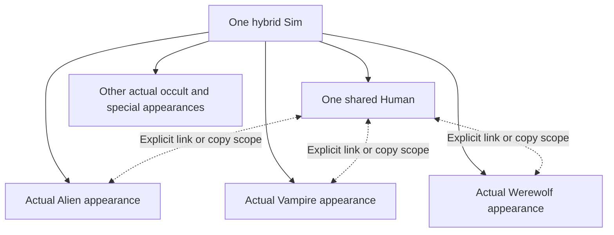

[← Apex](Home) · [CAS & content search](CAS-and-Content-Search) · [Merge notebook](Dynamic-CAS-Companion-Merge)

# ✦ Inside Apex
### Independent appearances. Native controls. Evidence you can inspect.

> **Development reference · October 21, 2026** 
> This page explains the implementation and the remaining release tests. “Implemented” means code exists; “qualified” requires evidence from the matching game build. Apex is not yet certified for an irreplaceable save.

## One Sim, one Human, many independent looks

A hybrid's occult membership and its appearance are different things. Membership determines gameplay; an appearance owns its clothes, skin, tattoos, presets, morphs, colors and other retained data. Giving a Sim Vampire and Alien gameplay must not make those appearances interchangeable.

Each appearance is addressed by the household, Sim and exact appearance owner. A form's rendering type is not its identity: two special appearances may use the same renderer without becoming the same saved appearance. Internal active aliases and retained backups must not appear as extra player forms. In particular, there is never a separate Human for each occult.

**The familiar pair stays familiar.** Alien retains EA's arrangement. Other forms with no paired interface need their own occult/special portrait and the same shared Human, using the Vampire-style interaction pattern. Reusing the portrait layout must not assign Vampire data or powers to those forms.

## What each component does

| Component | Job | Important boundary |
|---|---|---|
| **Native CAS `.package`** | Patches the actual CAS interface: portrait selection, category copy/link controls, catalog layout, equipped cards and keyboard work | Retains unrelated installed UI methods; a package is real UI modification, not an F11 screenshot |
| **Native sidecar DLL** | Owns the selected appearance graph, native synchronization fixes, rendering integration, 3D preview and background transport | Game objects remain on their owning callback thread; workers receive copied data |
| **Python 3.7 `.ts4script`** | Gameplay integration, canonical appearance banks, history, commands, household/Live routes and permanent preservation checks | Changing scripts requires a fresh game process; source files alone are not a working script archive |
| **Metadata and asset workers** | Read package resources, search the catalog, resolve images, prepare previews and open verified package copies in Studio | No package scanning or thumbnail decoding inside a card click or interaction-menu callback |
| **CLI and qualification tools** | Exercise real game paths, retain exact receipts, export complete appearance evidence and compare results | A completed request is not replayed because its receipt was inconvenient or a visual update was delayed |

The candidate bundles matching packages, script and DLL together. An old cached DLL with a new package is not an equivalent test environment.

## Editing and switching

The native engine captures complete appearance records, including fields an older feature might not understand. On a genuine form switch, it synchronizes the outgoing selected model, binds the chosen owner and checks that the resulting renderer, portrait and owner agree. The inactive partner is supplied from its own graph entry rather than accepted as an incidental copy of the outgoing form.

EA's stock two-slot synchronizer performs more than serialization: it can regenerate genetic/outfit data and copy between layers. Apex replaces the qualified destructive path with selected-model capture and explicit owner binding. The preservation guard remains enabled as a second line of protection; it is not a substitute for fixing the native behavior.

Unknown fields stay in complete records. Selective copying uses understood category boundaries, and refuses unsupported scopes rather than treating unknown fields as permission to copy everything.

### Link and copy mean different things

**Link** is an ongoing, explicitly chosen propagation relationship. **Unlink** stops future propagation. **Copy** is a one-time transfer from a named source to a named destination. Whole appearance, clothes, hair, body, details and other supported scopes must all retain this distinction.

A copy must not relay through unrelated links or another household member. Opening a menu or synchronizing an unchanged model is not a new edit. Complete serialized comparisons distinguish genuine edits from repeated reads.

## The catalog is not the wardrobe

The installed library contains EA and CC resources. The equipped view contains only the current appearance/outfit's worn parts. Search finds library candidates; swatches are variants of an item, not hundreds of separate base-item cards.

The native **All equipped** category uses EA's tile renderer and swatch controls. It publishes cards progressively, while the optional text inventory remains available for exact IDs and categories. Browsing has no reason to create or delete an outfit.

Package names, internal codes and localized titles remain separately available. A filename-derived creator is a useful **hint**, not verified authorship. A package containing a resource is not automatically the winning resource loaded by the game. [Content search explains the metadata chain](CAS-and-Content-Search).

## Performance without hidden work

Expensive metadata work happens outside gameplay callbacks. Search has a pinned read-only index, bounded cached pages and a latest-request worker. Hidden tools should not scan Sims, poll gameplay state or continually rebuild the catalog.

Native layout work is guarded by actual geometry/context changes. Progressive publication prevents a single event from binding every thumbnail synchronously. These improvements still need frame-time comparison on equivalent workloads; backend query timing alone cannot establish smoother gameplay.

## Current evidence and open failures

**V261 · current candidate.** Fresh full CAS entry passes the complete pre-entry comparison for all five Sims and 195 internal appearance records. A no-edit cycle through their shared Human appearances and household handoffs leaves every captured field unchanged. These records include stored variants; the count is audit coverage, not 195 distinct player forms.

**Correct the native destination.** The game's inspected household export writer chooses Human versus the first non-Human record. For a hybrid whose first stored occult differs from the form being exported, that can overwrite the wrong record and create a duplicate. V260 routes only authenticated CAS exports to the exact existing record during that native call, then restores the original record order. Ordinary exports, malformed rosters and other native callers remain outside the patch. The full edited return still needs runtime qualification. [Implementation and limits](https://github.com/Herbertofury/TD1-Occult-Hybrid-Apex/blob/apex/recover-and-harden/Reports/CAS_EXACT_OCCULT_RECORD_V260.json).

**Retain captured custom genetics.** V260's fresh-entry verifier caught five unique genetic part types disappearing from the stored Human/CC Werewolf appearance. V261 allows only types already present in that exact supplied genetic message, only while it imports into its exact temporary native destination and genus. The shared game predicate and unrelated imports are unchanged. The corrected fresh-entry and no-edit household passes use the retained look, with no reset that could hide the defect. [V261 evidence and remaining gates](https://github.com/Herbertofury/TD1-Occult-Hybrid-Apex/blob/apex/recover-and-harden/Reports/CAS_RETAINED_GENETICS_V261.json).

**Preservation limits remain explicit.** Creator metadata now has an exact root/occult wire mapping and passes the real detached native codec probe. The same codec omits Ghost color fields; preserving unrelated incoming wire fields does not establish per-form Ghost color support. That work remains open. Complete native CLI packets use bounded POST requests and retain their original request identity without automatic mutation replay.

**Responsiveness is measured separately.** V259's bounded member bootstrap is included, but the actual native portrait-click timing run is pending. Semantic CLI operation duration and cold room initialization cannot establish player click latency or a universal 0–1 ms guarantee.

### Earlier test history

The V253 equipped-category qualification covered five household members and a return to the first, publishing complete native thumbnail views without unresolved slots. Its recorded same-member publication maximum was 10 ms and native binding maximum 5 ms. Cold/member changes were slower; this is not a 0–1 ms end-to-end claim.

A first real Alien → Vampire → Alien run read back distinct eyebrow, skin-detail and earring edits but failed its strict comparison because Human genetic data changed. Forensics found the updated physique already present in that Human's own scalar data, and the updated hairstyle already present in its ordinary outfits. Other genetic root chunks, other part rows and unknown fields remained identical. This supports genetic-cache reconciliation, not a demonstrated Alien-to-Human appearance merge. Controlled initialization qualification remains open; the comparison was not weakened.

The second household member then passed six actual Alien/Vampire category edits and three repeated form visits. All 193 other retained appearance records and all 20 save/backup files remained unchanged. This covers three categories on that member, not the full release matrix.

Members three and four also passed their six selections and repeated Alien/Vampire visits. The later fifth-member handoff nevertheless changed member four's Alien outfits and genetics after its earlier export. The added eyebrow/skin-detail parts match member four's own approved choices, and its genetic physique then matches its already stored scalar physique. This is consistent with delayed outgoing-model synchronization; it does not prove a cross-member merge. The controlled follow-up then explicitly flushed member five while still unlinked: all 39 of its complete records remained identical after leaving it. This qualifies that one settled handoff. It does not convert the earlier failed baseline into a pass or qualify the whole edited CAS/Live/save/Tray matrix. No CAS acceptance or save was sent.

A separate Bald eyebrow swatch still returned a different native swatch. CAS acceptance and saving were withheld for these tests.

Counts such as 195 retained internal records are useful audit coverage, but do not prove 195 real forms or successful editing. Release requires visually distinct actual forms, all supported categories, all household members, CAS/Live/MCCC/F11 routes, normal save/cold-load and Tray/Gallery round trips.

**Trace the work:** [PR #8](https://github.com/Herbertofury/TD1-Occult-Hybrid-Apex/pull/8) · [shared-Human requirements](https://github.com/Herbertofury/TD1-Occult-Hybrid-Apex/blob/apex/recover-and-harden/docs/CAS_SHARED_HUMAN_REQUIREMENTS.md) · [open issues](https://github.com/Herbertofury/TD1-Occult-Hybrid-Apex/issues)
